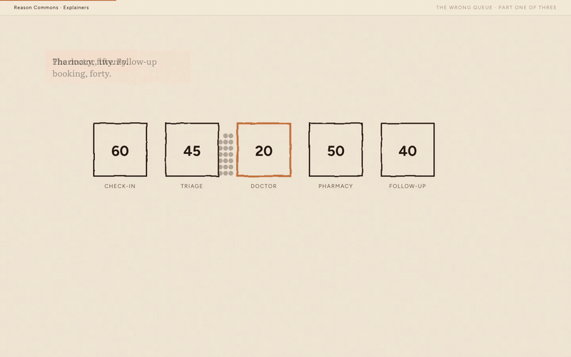

# Scrollable explainer

An AI agent skill for making illustrated stories whose graphics unfold as you scroll. Learn the form, write and critique the script, plan its visual beats, then build and check it in a browser.

[](https://reasoncommons.com/explainers/01-bottleneck/index.html)

[Watch the 44-second scrolling demo](media/demo.mp4) · [Read the live story](https://reasoncommons.com/explainers/01-bottleneck/index.html)

The embedded preview is a 10-second GIF (663 KB). The full video is a silent recording of the live page, from its opening clinic story to the bottleneck reveal. [Capture source and instructions](media/README.md).

## Install

```sh
npx skills add rufuspollock/scrollable-explainer -s scrollable-explainer
```

Then ask your agent: “Use the scrollable-explainer skill to help me make a visual explainer about [subject]. Start with the story and drawing budget.”

Read [the skill](SKILL.md) directly, or explore [the background research](research/README.md): a ProPublica teardown, reference screenshots, the CoStar teardown, and the scripts, critiques and revisions behind the Reason Commons series.

## See the results

These scrolling explainers were developed using the skill:

- [The Wrong Queue](https://reasoncommons.com/explainers/01-bottleneck/index.html) — the bottleneck story that started the trilogy.
- [The Arrows Nobody Checks](https://reasoncommons.com/explainers/02-thinking-made-visible/index.html) — how a drawing makes reasoning inspectable.
- [Five Shapes](https://reasoncommons.com/explainers/03-five-shapes/index.html) — five questions that guide a change.
- [The Forum Doesn't Remember, and Doesn't Cumulate](https://reasoncommons.com/explainers/second-renaissance/index.html) — a scrolling application to a real community's reasoning.

[Browse the series](https://reasoncommons.com/explainers/index).

## What's here

| File | Purpose |
|---|---|
| [SKILL.md](SKILL.md) | Form, narrative discipline, visual patterns and browser verification |
| [ProPublica case study](case-study-propublica-ccs.md) | Detailed measured teardown of the reference piece |
| [Reference images](reference/) | Four screenshots accompanying that teardown |
| [Research archive](research/README.md) | 48 original working files, source links and checksums |

## Origins and credits

Extracted from [Reason Commons](https://github.com/reasoncommons/reasoncommons), where the skill was developed by Rufus Pollock and collaborators. It is now independently installable; Reason Commons keeps its published explainers and project records.

The original material retains its [MIT license](LICENSE) and Life Itself copyright notice. The ProPublica × Drilled article, quoted excerpts and reference screenshots belong to their respective creators; they are included as attributed research material, not relicensed as original artwork. See the [case study](case-study-propublica-ccs.md) for the source and methodology.

Development tasks live in Beads (`bd ready`); [agent instructions](AGENTS.md) cover contributing, synchronization and changelogs.
