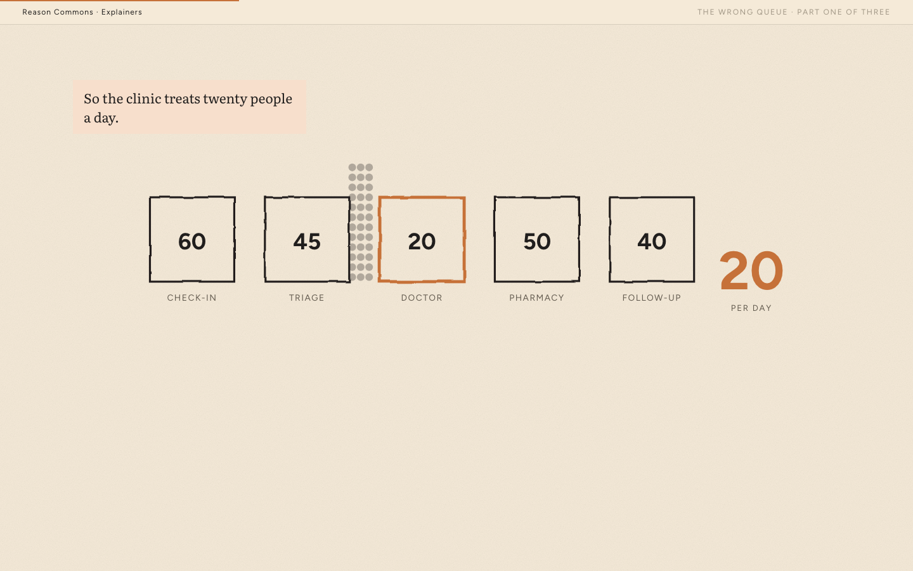

The [scrollable-explainer skill](https://github.com/rufuspollock/scrollable-explainer) now has its own home, with publisher teardowns, original research and worked drafts from Reason Commons. Explore the live demos or watch a [44-second recording of The Wrong Queue](../media/demo.mp4) to see what it produces.

